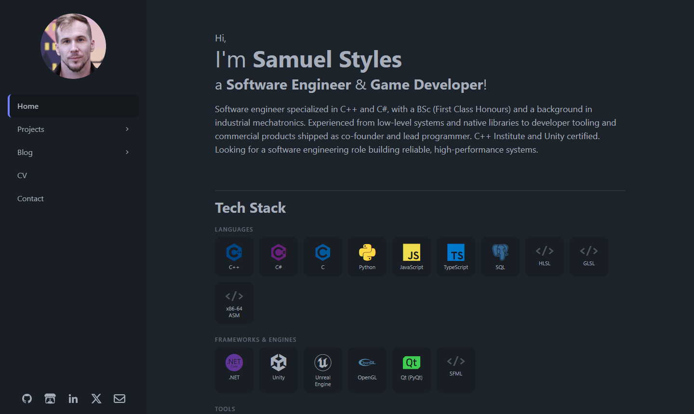
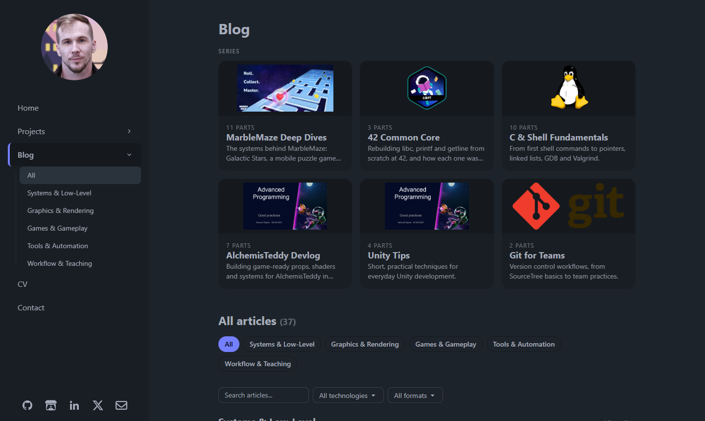

# Samuel Styles — Portfolio & Technical Blog

[](https://github.com/SStyles93/SStyles93.github.io/actions/workflows/deploy.yml)


[](LICENSE)

Source of **[sstyles93.github.io](https://sstyles93.github.io/)**: my portfolio, CV and technical
blog. I'm a software engineer working in C++ and C#. The site covers systems and low-level
work, graphics, games and developer tooling.



## What's inside

- **Projects and articles organized by area**: Systems & Low-Level, Graphics & Rendering,
  Games & Gameplay, Tools & Automation, Workflow & Teaching. Each area has its own page,
  listing both projects and articles.
- **Series**: multi-part articles (MarbleMaze Deep Dives, 42 Common Core, C & Shell
  Fundamentals…) with part numbers, a "Part x of y" dropdown and previous/next navigation.
- **Formats and tech tags**: every article is a case study, deep dive, tutorial or notes, and
  is tagged with the technologies it uses.
- **Search and filters** on the listing pages, by text, technology and format.
- **Sidebar navigation** that highlights the current section and opens the area list for
  Projects and Blog.
- **Web CV** mirroring the PDF version, with a downloadable PDF.
- **RSS feed** at [`/rss.xml`](https://sstyles93.github.io/rss.xml) and page transitions via
  Astro's `ClientRouter`.
- **Sitemap** for search engines at
  [`/sitemap-index.xml`](https://sstyles93.github.io/sitemap-index.xml), referenced in
  `robots.txt`. Teaser redirect pages are left out.



## Tech stack

| | |
|---|---|
| Framework | [Astro 6](https://astro.build/), content collections with Zod schemas, MDX |
| Styling | Tailwind CSS 3, DaisyUI 4, `@tailwindcss/typography` |
| Images | `astro:assets` (Sharp), GLightbox for full-screen viewing |
| Tooling | pnpm, Puppeteer (PDF export) |
| Hosting | GitHub Pages, deployed by GitHub Actions |

## Project structure

```text
src/
├── content/
│   ├── projects/        # one .mdx file per project
│   └── blogs/           # one .mdx file per article
├── content.config.ts    # collection schemas (validated at build time)
├── data/
│   ├── taxonomy.ts      # areas, tech tags, formats and series: the single source of truth
│   └── cv.ts            # CV content (experience, skills, education…)
├── utils/content.ts     # sorting, series lookup, URLs, counts
├── components/          # cards, filters, series navigation, sidebar…
├── layouts/             # BaseLayout, ProjectLayout
└── pages/               # routes: /projects, /blogs, /cv, /rss.xml…
scripts/                 # image index, image rewriting, PDF export
public/pdf/              # CV, certificates and documents linked from the site
```

## Writing content

Add an `.mdx` file to `src/content/projects/` or `src/content/blogs/`. The file name becomes
the URL (`42_Core_Libft.mdx` → `/blogs/42_core_libft/`). Files starting with `_` are treated
as drafts and are not built.

**Project**

```yaml
---
title: "CodeTester — An Interactive C Tester for 42 Projects"
description: "One or two sentences shown on cards and in search results"
creationDate: "Oct 24 2026"
order: 0                      # lower comes first; ties are sorted newest first
heroImage: "/src/assets/images/icons/C_Icon.png"
teamSize: 1
timeFrame: "2 weeks"
toolUsed: "C/GCC/Make"
isProject: true
category: "systems"           # an area id from taxonomy.ts
tags: ["C", "Linux"]          # tech ids from taxonomy.ts
---
```

**Article in a series**

```yaml
---
title: "42 Common Core — Libft: Rebuilding the C Standard Library"
description: "…"
creationDate: "Oct 13 2026"
order: 0
heroImage: "/src/assets/images/42/libfte.png"
teamSize: 1
toolUsed: "C/GCC/Make"
isProject: false
category: "systems"
kind: "deep-dive"             # case-study | deep-dive | tutorial | notes
tags: ["C", "Linux"]
project: "42_codetester"      # optional: links the article to a project page
series: { id: "42-core", part: 1 }
---
```

Things worth knowing:

- **`src/data/taxonomy.ts` defines every allowed value.** Areas, tech tags, formats and series
  are enums in the schema, so a typo fails the build instead of creating an empty category.
  To add a new area, tag or series, add it there first.
- **Series order:** the order of the series in `taxonomy.ts` is the order they appear on the
  site. Within a series, the latest part is listed first.
- **Teaser posts** (`isProject: true` in `blogs/`) don't get their own article page. They
  redirect to the project they point to with `project`. A teaser with a `series` still appears
  in the article lists, so the part numbering has no gaps.
- **Tag labels:** tag ids stay stable because they appear in URLs (`/blogs/tags/CPP/`). Their
  display names (`C++`, `Unreal Engine`…) are set in `techLabels`.

## Credits & license

- The site started from an MIT-licensed Astro portfolio template by
  **Manuel Ernesto Garcia**. It has since been heavily reworked.
- 42 project badges: [ayogun/42-project-badges](https://github.com/ayogun/42-project-badges)
  (MIT).
- The **code** is released under the [MIT License](LICENSE). The **articles, images and CV
  content** are © Samuel Styles. Please ask before reusing them.
